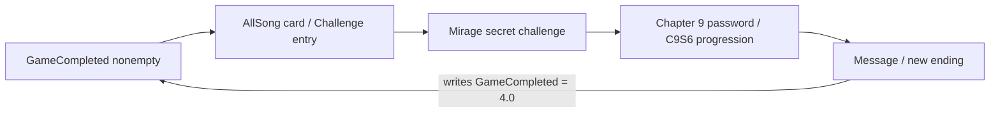

# Phigros 4.0.1: Distorted Fate ending and progression regression

This report corrects the original conclusion that the Chapter 8 DF story route reaches credits. Native addresses are RVAs in the ARM64 image, base zero. Read-only IDA MCP analysis and actual APK serialized configuration were used; community observations supplied by the user were not independently reproduced on a device.

## Actual Distorted Fate ending

`DFLevelEffect.Update` (`0x1CD0FB0`) saves chart results/records and, for IN >= 920000, `DistortedFateINSGrade`. It transitions to `QDEvent`. The final state of `QDEventControl.<Start>d__5.MoveNext` (`0x1CD5FE0`) calls `BlackScreen.Show("ChapterSelector", 0.5)` at `0x1CD68A4`.

There is no transition to `AboutUs` and no write of `chapter8Passed` / `C8DistortedFateUnlocked` in that ending path. The earlier answer incorrectly inferred reachability from the presence of old writer code.

`AboutUs.Back` (`0x1CB21C8`) still contains the old writes: if `chapter8Passed` is false, set `chapter8Passed=true` at `0x1CB2540` and `C8DistortedFateUnlocked=true` at `0x1CB2558`. These are not automatically invoked by playing the DF story chart in this build.

This explains why a valid DF score record, or even the IN S-grade flag, does not make the Chapter 8 song entry permanently available. The entry requires its separate `C8DistortedFateUnlocked` flag; AT additionally checks `chapter8Passed` and `DistortedFateINSGrade`.

## Why Chapter 9 can open anyway

The actual MainStory9 serialized selector condition is:

```json
{"unlockMode":1,"unlockFlag":"DistortedFate.Sakuzyo.0"}
```

`ChapterSelector.Start` (`0x1D535F0`), case 1 at `0x1D5543C`, evaluates this song's records against **880000**. Helper `0x1D55AD8` uses `All(record.score < 880000)`; its predicate is `0x1D56CF0`. The chapter remains locked if all matching records are below the threshold. Consequently **any difficulty's Distorted Fate record >= 880000 opens Chapter 9**, independently of the permanent song unlock and chapter-completion flags. Finishing the story at an arbitrary low score is not itself sufficient to satisfy this chapter selector condition.

`Chapter9UnlockBegin` is saved on entry to `Chapter9Phase1Control.Start` (`0x1CF87D0`), not by the DF ending.

Exact asset decoding and native evidence are in [df_transition/FINDINGS.md](../distorted_fate_followup/df_transition/FINDINGS.md).

## New credits location

The current final sequence is:

```text
MessageLevelEffects.Update 0x1D469EC
  -> Deduction (LoadScene call 0x1D46C30)
C9DeductionControl.<FinishAndWhiteOut>.MoveNext 0x1CF2440
  -> AfterDeduction (LoadScene call 0x1CF24F4)
C9AfterDeductionControl.<Start>.MoveNext 0x1D3FFB0
  -> writes Chapter9Phase2Passed, four C9 song unlocks, GameCompleted="4.0"
  -> PlayerPrefs.Save at 0x1D401B0
  -> new credits
C9AfterDeductionControl.Back 0x1D3FC00
  -> BootScene -> ChapterSelector
```

The new ending **does not write the old Chapter 8 flags** and does not call `AboutUs.Back`. `GameCompleted` is saved on entering the new ending coroutine, before its rolling credits finish.

The old credits' settings entry is hidden when `GameCompleted != "4.0"`: `Setting.Start` (`0x1D93C18`), comparison at `0x1D94C88`, hides its parent GameObject at `0x1D94CC4`. Thus settings does not provide the normal pre-completion bypass on a fresh save.

Full new-ending decompilations: [credits_followup/README.md](credits_followup/README.md).

## Challenge dependency

`RemoveAllSongControl.Awake` (`0x1D5766C`) destroys its own GameObject when `LoadString("GameCompleted", "") == ""` (literal empty-string equality). APK scene `level6` proves this component (path ID 4382) is on `AllSong` (GameObject 638), whose descendants include `MoreInfo` (658) -> `ClassMode` (17). The ClassMode Button (3702) serializes the call `LoadSongSelector("ChallengeMode")`, handled by `ChapterSelector.LoadSongSelector` at `0x1D560E4`. Destroying the parent removes the actual Challenge Mode entry, not merely an unrelated song card. See [challenge_followup/README.md](challenge_followup/README.md).

The normal Chapter 9 route requires that Challenge Mode:

1. `ExoplanetaryMirageUnlock.IsProcessActive` (`0x1D0A4FC`) requires `Chapter9UnlockBegin`, Mirage not already unlocked, and collection `poyidomejiu1` read.
2. `IsValidUnlockSelection` (`0x1D0A7F4`) requires exactly two challenge items, with the same difficulty, in order **Evanescent -> About The Universe**. `GetPendingHiddenThirdSongId` (`0x1D0A790`) supplies **Exoplanetary Mirage** as the hidden third song.
3. `ChallengeSongSelectorControl.Play` (`0x1CE1544`) appends that hidden song and loads the actual `ChallengeMode` scene. Challenge result processing (`0x1D219A4`, `0x1D21D38`) writes `C9ExoplanetaryMirageUnlocked` on the appropriate successful secret challenge path.
4. `Chapter9Phase1Control.OpenInputPassword` (`0x1CFCA28`) checks that Mirage flag at `0x1CFCAA4` before opening the password UI. The correct-password callback chain then enters C9S6 (`0x1D49C38` -> `0x1D49DD8` -> `0x1D4A144` -> `C9S6Unlock.StartC9S6`, `0x1CF3380`). Thus the missing challenge access blocks main story continuation, not merely an optional song-list unlock.

Exact conditions and decompilations: [ch9_followup/README.md](ch9_followup/README.md).

For a fresh save using the normal UI, the dependency is circular:



This circular entry dependency and the missing C8 completion writes are separate issues. Merely reaching the new credits would set `GameCompleted` but still would not execute the old `AboutUs.Back` writes for permanent DF availability.

## Scope

No binary patches, save edits, or IDB modifications were made. Imported/cloud saves or other preexisting completion state must be considered separately from a fresh save. The save import module `GameProgressSaveModule.Apply` restores completion and Chapter 8 flags from imported fields (`0x1D6356C`, `0x1D63CF8`); these are restoration paths, not successful story-completion writes.
